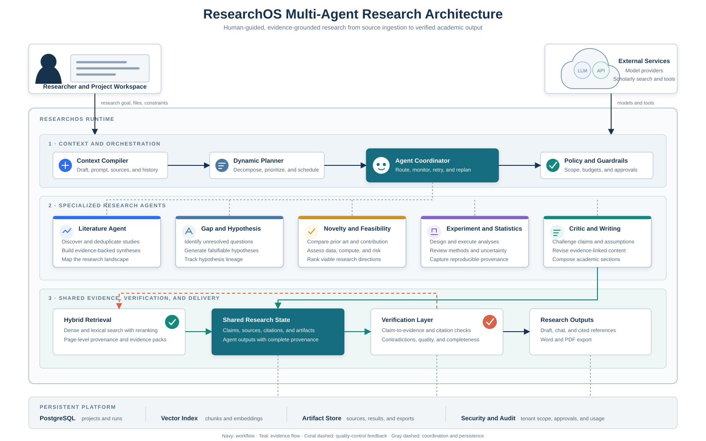
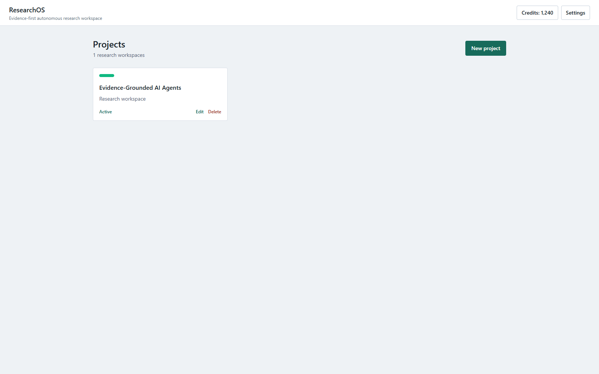
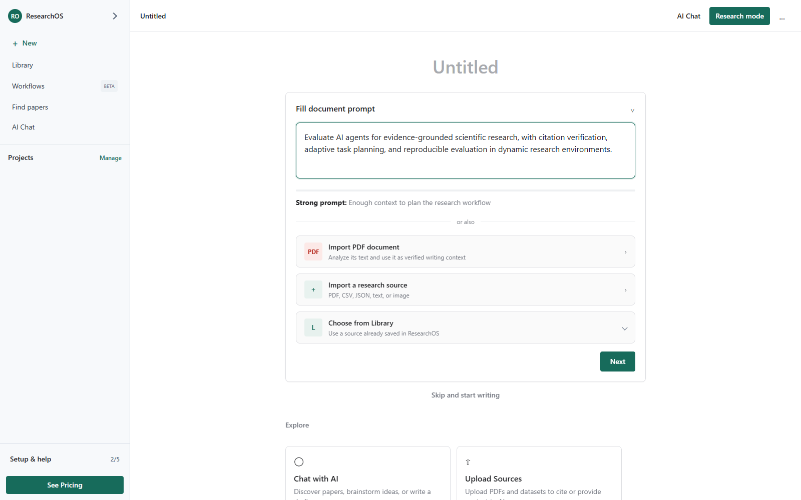
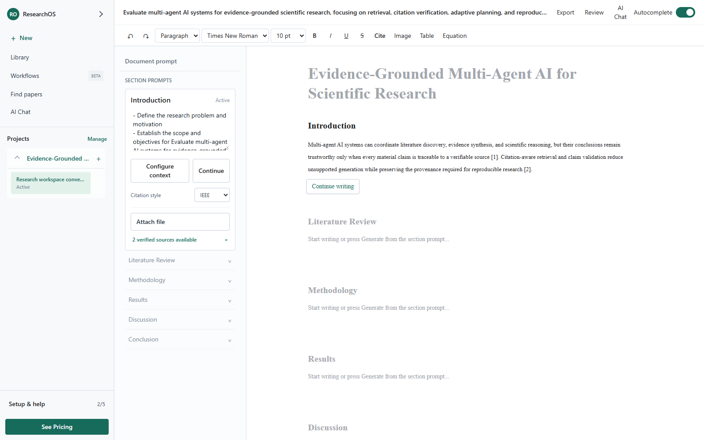
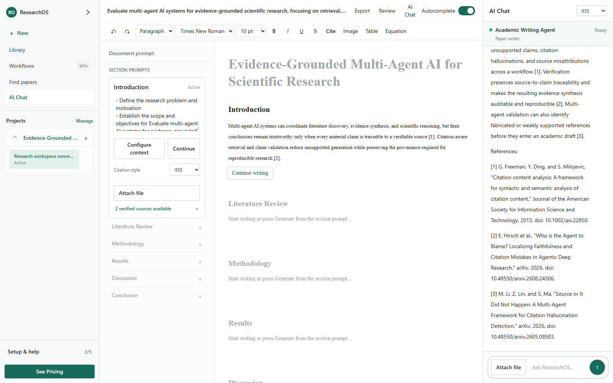

# ResearchOS

ResearchOS is a full-stack research and academic-writing workspace for building evidence-grounded documents with AI assistance. It combines project organization, source management, scholarly search, retrieval, specialized research agents, citation-aware generation, and an editable manuscript in one interface.

The current application is an engineering prototype, not a fully autonomous researcher. It supports end-to-end local workflows while keeping model providers, scholarly search providers, object storage, vector search, and agent tools behind replaceable interfaces.

## Current Product

- Create, rename, and delete research projects and persistent conversations.
- Import PDF, CSV, JSON, text, and image files into a reusable project Library.
- Search for scholarly papers and save an open-access PDF or, when a PDF is unavailable, save the paper summary and metadata.
- Build a structured manuscript with Introduction, Literature Review, Methodology, Results, Discussion, and Conclusion sections.
- Generate one connected sentence at a time using the current document, section prompt, selected sources, and retrieved literature.
- Accept, regenerate, or dismiss a sentence before it becomes part of the draft.
- Display only references that are actually cited in the manuscript.
- Format citations and references as **IEEE**, **APA 7**, **Harvard**, or **MLA 9**.
- Chat about the current project and its sources, edit and resubmit prompts, attach files, and view the active research agent.
- Export the formatted manuscript as a Word-compatible `.doc` file or through the browser's Save as PDF workflow.

## Architecture



[Open the vector architecture as SVG](docs/assets/researchos-architecture.svg) or [download the PDF](docs/assets/researchos-architecture.pdf). Both formats remain sharp when zoomed.

The main workflow is:

1. Research questions and imported sources enter the document-intelligence pipeline.
2. Parsed content is semantically chunked and indexed with source provenance.
3. Dense and lexical retrieval are fused into traceable evidence packs.
4. Specialized agents perform literature analysis, gap analysis, hypothesis generation, novelty review, feasibility review, scientific criticism, statistical review, ranking, and code-oriented evaluation.
5. Claims and citations are checked before generated text is presented to the researcher.
6. Accepted text, references, conversations, and research state remain scoped to the current organization and project.

PostgreSQL stores transactional records. MinIO stores uploaded binaries, Redis supports coordination, and Chroma provides vector retrieval. The API, worker, web application, and shared research packages are maintained in one monorepo.

## Product Screenshots

| Project management | Document setup and source selection |
| --- | --- |
|  |  |

### Citation-Aware Draft Generation

The editor uses the active section prompt and existing manuscript context to produce connected text. Accepted citations are reflected in the manuscript reference list.



### Research Chat with References

The research assistant can generate a source-grounded answer, show the active agent, and return a formatted reference list using the selected citation style.



## Implemented Features

### Research Workspace

- Account registration, login, access and refresh tokens, logout, and organization-scoped authorization.
- Project and conversation creation, editing, deletion, pagination, and PostgreSQL persistence.
- Scrollable project navigation and chat history with an option to load earlier messages.
- Editable user prompts that can be resubmitted to regenerate an answer.
- Streaming assistant output and a compact current-agent status panel.
- Project Library with import, selection, download, and deletion controls.

### Academic Editor

- Section-specific prompts and context configuration.
- Sentence-level generation that reads the current draft before producing a continuation.
- Accept, regenerate, and dismiss controls for generated suggestions.
- Automatic citation ordering and a References section containing only cited sources.
- IEEE, APA 7, Harvard, and MLA 9 citation and bibliography formatting.
- Paragraph and heading styles, multiple font families, font sizes from 8 to 32 points, bold, italic, underline, and strike-through formatting.
- Editable tables with row, column, and table insertion or deletion controls.
- Local image insertion with left, center, and right alignment.
- Equation insertion, undo and redo, document review, autocomplete control, and export.

### Documents and Retrieval

- Validated file upload, listing, download, deletion, and duplicate detection.
- PDF parsing with page, section, table, figure, and source metadata.
- Semantic chunking that retains tenant, project, document, page, and section provenance.
- Dense and lexical retrieval combined through reciprocal-rank fusion and reranking.
- Evidence packs that keep retrieved content connected to its source.
- Project-scoped scholarly search with deduplication, filtering, and reference metadata.

### Research Agents and Verification

- Literature discovery and evidence synthesis.
- Research-gap analysis and structured hypothesis generation.
- Hypothesis lineage, mutation, combination, specialization, and rejection.
- Novelty, feasibility, scientific-critic, statistical-reviewer, tournament, and code-agent modules.
- Context compilation, dynamic planning, task scheduling, retry, repair, and resumable run models.
- Claim-to-evidence validation, contradiction checks, and citation verification.
- OpenAI, OpenAI-compatible, Ollama, and deterministic development model adapters.

### Platform Engineering

- FastAPI services, SQLAlchemy async persistence, Alembic migrations, and a background worker.
- Tenant-scoped storage paths and authorization checks.
- Docker Compose services for the web application, API, worker, PostgreSQL, Redis, Chroma, and MinIO.
- Pytest and Vitest suites, Ruff, strict MyPy, TypeScript checks, and GitHub Actions configuration.

## Citation Behavior

Citation style is selected independently for the document editor and research chat. The available styles are:

| Style | Example in-text citation |
| --- | --- |
| IEEE | `[1]` |
| APA 7 | `(Smith, 2025)` |
| Harvard | `(Smith 2025)` |
| MLA 9 | `(Smith)` |

The source catalog and the manuscript bibliography are intentionally different:

- **Available sources** are files or papers that can be used as evidence.
- **References** are the subset of those sources that are cited in accepted draft text.

This prevents the References section from listing every uploaded or discovered source when the manuscript has not used it.

## Technology Stack

| Layer | Technologies |
| --- | --- |
| Frontend | Next.js 15, React 19, TypeScript, Tailwind CSS, Vitest, Testing Library |
| Backend | Python 3.12, FastAPI, Pydantic, SQLAlchemy Async, Alembic |
| Agent runtime | LangGraph, typed research-agent services, provider gateways |
| Data and retrieval | PostgreSQL, Redis, Chroma, MinIO, dense and lexical retrieval |
| Model adapters | OpenAI, OpenAI-compatible APIs, Ollama, deterministic local provider |
| Infrastructure | Docker Compose, background worker, GitHub Actions |
| Quality | Pytest, Ruff, strict MyPy, TypeScript compiler checks |

## Repository Structure

```text
apps/
  api/                 FastAPI routes, services, persistence, and tests
  web/                 Research workspace and academic editor
  worker/              Background-job execution
packages/
  agents/              Specialized scientific agents and workflows
  billing/             Credits, metering, budgets, and payment foundations
  core/                Shared security and deployment policies
  documents/           PDF, table, figure, and dataset processing
  evaluation/          Evaluation models and metrics
  execution/           Sandbox, experiments, repair, and reproducibility
  observability/       Structured runtime events
  rag/                 Chunking, retrieval, evidence packs, and cited answers
  tools/               MCP and external tool gateways
  verification/        Claim, evidence, and citation verification
  writing/             Academic-writing services
docs/                  Architecture, screenshots, API notes, and decisions
infra/docker/          API, web, and worker container images
migrations/            Alembic database migrations
```

## Local Development

### Docker Quick Start

Docker Desktop with Docker Compose is the simplest way to run the complete local stack. The deterministic development provider can run without an external model API key.

```powershell
git clone https://github.com/polashdas040/ResearchOS.git
Set-Location ResearchOS
Copy-Item .env.example .env
docker compose up --build -d
docker compose exec api alembic upgrade head
```

On macOS or Linux, create the environment file with:

```bash
cp .env.example .env
```

Available services:

- Web application: `http://localhost:3000`
- API documentation: `http://localhost:8000/docs`
- MinIO console: `http://localhost:9001`

Check the stack:

```bash
docker compose ps
docker compose logs -f api web worker
```

Stop the stack without deleting development data:

```bash
docker compose down
```

Remove containers and local Docker volumes:

```bash
docker compose down -v
```

### Run Without Docker

This path requires Python 3.12+, Node.js 20+, PostgreSQL, Redis, Chroma, and S3-compatible object storage configured in `.env`.

```bash
pip install -e ".[dev]"
npm install
alembic upgrade head
```

Run the API and web application in separate terminals:

```bash
uvicorn apps.api.app.main:app --reload --port 8000
npm --workspace apps/web run dev
```

## Development Commands

- `make dev` starts the Docker Compose stack.
- `make test` runs Python and web tests.
- `make lint` runs Ruff, MyPy, and TypeScript checks.
- `make format` formats Python and web source files.
- `make migrate` applies Alembic migrations.
- `make migration message="description"` creates a migration.

## Current Limitations

- Quality depends on the configured model and scholarly-search providers.
- Scanned or highly complex PDF layouts may require stronger OCR and layout extraction.
- Collaboration, manuscript version comparison, and production deployment hardening are not complete.
- Large-scale retrieval, citation-quality, security, load, and recovery evaluation remains ongoing.

## License

No license has been published for this repository. All rights are reserved unless a license file is added.

